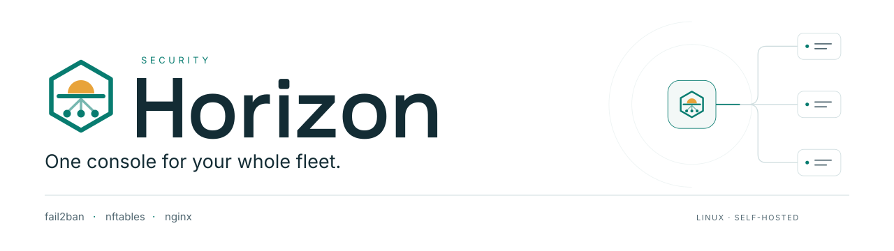
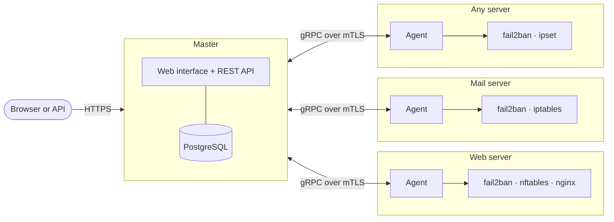

<p align="center">
  <picture>
    <source media="(prefers-color-scheme: dark)" srcset="assets/banner-dark.svg">
    
  </picture>
</p>

<p align="center">
  Self-hosted security management for Linux servers, built on fail2ban, nftables and nginx.
</p>

<p align="center">
  <a href="https://github.com/Fat2Nash/horizon-releases/releases"></a>
  <a href="#requirements"></a>
  <a href="#verifying-a-release"></a>
  <a href="./LICENSE"></a>
</p>

<p align="center">
  <a href="https://fat2nash.github.io/horizon-security/en/docs">Documentation</a> ·
  <a href="https://fat2nash.github.io/horizon-security/en/docs/quickstart">Quickstart</a> ·
  <a href="https://fat2nash.github.io/horizon-security/en/docs/reference/api">API reference</a> ·
  <a href="https://github.com/Fat2Nash/horizon-releases/issues">Issues</a>
</p>

---

Horizon manages the security of a fleet of Linux servers from a single web interface. It does not replace the tools
you already trust: a lightweight agent on each server drives **fail2ban**, **ipset / iptables / nftables** and
**nginx**, and the master shares every decision across the fleet. An IP that attacks one server can be blocked on all
of them, by hand or by a rule.

This repository contains **published releases only**: signed binaries, the install script and update manifests.

> [!NOTE]
> Horizon is in **beta**. It runs in production, but the interface and the API may still change between beta
> releases. Start in [observation mode](https://fat2nash.github.io/horizon-security/en/docs/guides/observation):
> Horizon analyses and decides, but applies nothing until you are ready.

## Features

- **Fleet bans** — block an IP on one server, a group, servers selected by labels, or the whole fleet, and see where
  each ban is actually applied.
- **Automatic rules** — thresholds, repeat offenders and escalation to permanent bans, tested in simulation first.
- **Shared allowlist** — propagated to fail2ban, the firewall and nginx rate limits, so your own IPs are never banned.
- **Investigation** — per-IP history across servers, threat overview, on-demand server logs and a full audit trail.
- **Observation mode** — see what Horizon would do before it touches anything.
- **Operations** — configuration policies per group, backups (local, SFTP, S3, Borg, restic), signed updates for the
  master and rolling updates for agents, notifications (email, Slack, Discord, Teams, Telegram, ntfy, webhooks).
- **API first** — every action is available through a documented REST API
  ([OpenAPI](https://fat2nash.github.io/horizon-security/openapi.json)), with API keys for automation.

## Installation

Install the master on a Debian or Ubuntu server:

```bash
curl -fsSL https://github.com/Fat2Nash/horizon-releases/releases/latest/download/install.sh | sudo sh
```

The script checks the system, downloads the release and verifies its signature and checksum before writing anything.
It then sets up PostgreSQL and the systemd service, and prints a one-time link to the web wizard that finishes the
setup: administrator account, web access and the first protected server.

Then add your servers from **Infrastructure › Servers › Add a server**. The command shown there installs the agent
from your own master, with its binary and certificate authority pinned.

<details>
<summary>Other ways to install</summary>

<br>

| Use case | Command |
| --- | --- |
| A specific beta | `curl -fsSL https://github.com/Fat2Nash/horizon-releases/releases/download/v<version>/install.sh \| sudo sh -s -- --version <version>` |
| Unattended (Ansible, cloud-init) | `… \| sudo sh -s -- --non-interactive --admin-password-file /root/horizon-admin.pass` |
| Offline server | download the archive and its `.minisig`, then `sudo sh install.sh --from-archive horizon_<version>_linux_amd64.tar.zst` |
| Move an existing install | `sudo sh install.sh --import horizon.hzb` (from `horizon export`) |

See [Install the master](https://fat2nash.github.io/horizon-security/en/docs/quickstart/master) and
[Unattended install](https://fat2nash.github.io/horizon-security/en/docs/quickstart/unattended).

</details>

## How it works



The **master** is a single binary with the web interface built in. Each server runs an **agent** that enforces
decisions with the tools already in place and reports events back. Each agent has its own certificate; raw logs stay
on the servers and are read on demand.

## Requirements

| | |
| --- | --- |
| Operating system | Debian 12 or 13, Ubuntu 22.04 or 24.04 (amd64 or arm64) with systemd |
| Privileges | root or sudo |
| Database | PostgreSQL, installed by the script, or an existing database |
| Network | an HTTPS reverse proxy in front of the web interface; the agent port (8443 by default) reachable from your servers |

## Verifying a release

Every artifact is signed with [minisign](https://jedisct1.github.io/minisign/) (Ed25519). `install.sh` verifies
signatures on its own; to check a download by hand:

```bash
minisign -Vm horizon_<version>_linux_amd64.tar.zst -P <public key>
minisign -Vm SHA256SUMS -P <public key> && sha256sum -c SHA256SUMS --ignore-missing
```

Release public key (stable and beta):

```text
RWQoNgViztHg4F3FhwpkzghDM4rLIesHbdaXExmrmIV8fYsq1dfrXo8q
```

An archive whose signature does not match this key is not a Horizon release. Do not install it.

<details>
<summary>Release contents</summary>

<br>

| File | Purpose |
| --- | --- |
| `install.sh` | master installer, with the release key embedded |
| `horizon_<version>_linux_{amd64,arm64}.tar.zst` + `.minisig` | master (web interface included) and agent binaries |
| `channel-{stable,beta}.json` + `.minisig` | channel manifest read by the installer and by automatic updates |
| `SHA256SUMS` + `.minisig` | checksums of every file |
| `*.sbom.json` | software bill of materials |

</details>

## Updating

The master watches its release channel through a signed manifest. Updates run from **Administration › System** or with
`sudo horizon update apply`: a backup is taken first, health is checked afterwards, and the previous version is
restored automatically on failure. Agents are updated from the master in waves.

## Documentation

The full documentation is available in [English](https://fat2nash.github.io/horizon-security/en/docs) and
[French](https://fat2nash.github.io/horizon-security/fr/docs): installation, guides, CLI and configuration reference,
REST API and security model.

## Support

- **Bugs and questions** — [open an issue](https://github.com/Fat2Nash/horizon-releases/issues) and include the output
  of `sudo horizon doctor`, which contains no secrets.
- **Security vulnerabilities** — report them privately through **Security › Report a vulnerability** in this
  repository, never in a public issue. See the
  [disclosure policy](https://fat2nash.github.io/horizon-security/en/docs/security/disclosure).

## License

[MIT](./LICENSE) © Fat2Nash
